<div align="center">


```text
  /\_/\
 ( o.o )   purr... shipping AI systems, one paw at a time
  > ^ <
```


<a href="https://harshaaalll.github.io/"></a>
<a href="https://www.linkedin.com/in/harshal-bhambhani-hhbb24"></a>
<a href="mailto:bhambhaniharshal@gmail.com"></a>


<br /><br />


<sub>🐟 A koi drawn from my public GitHub activity, redrawn every night. (The cat is watching it.)</sub>

</div>

---

## 🐾 About me

- 🎓 Graduate of **BITS Pilani, Hyderabad Campus**
- 🔭 Building **retrieval-augmented generation (RAG)** systems, **multi-agent workflows** and the **evals** that keep them honest
- 🧪 Interested in human-approved agent actions, trace-level evaluation and voice / speech pipelines
- 😺 Curious like a cat: I poke at things until I understand how they work
- 📫 Best way to reach me: LinkedIn or email, both above

---

## 🧶 Tech stack

<div align="center">


<br /><br />


</div>

---

## 🐱 Featured projects

| Project | What it is |
| --- | --- |
| [🐾 **regrag**](https://github.com/Harshaaalll/regrag) | RAG benchmark work on regulatory documents |
| [🐾 **opsagent**](https://github.com/Harshaaalll/opsagent) | Autonomous AI operator: plan-act-verify loop over a real browser, with approval gates and independent verification |
| [🐾 **sanwaad**](https://github.com/Harshaaalll/sanwaad) | Multi-agent complaint resolution with human-approved actions and trace-level evals (LangGraph, Gemini, hybrid RAG) |
| [🐾 **career-copilot**](https://github.com/Harshaaalll/career-copilot) | AI-powered job search system: RAG matching, ATS optimization and more (Streamlit, LangChain, FAISS, Groq) |
| [🐾 **audit-insight**](https://github.com/Harshaaalll/audit-insight) | NLP analytics that turn unstructured audit text into structured, actionable insights |
| [🐾 **airfare-ml**](https://github.com/Harshaaalll/airfare-ml) | End-to-end airline ticket price prediction (XGBoost, LightGBM, scikit-learn) |
| [🐾 **social_media_scrapper**](https://github.com/Harshaaalll/social_media_scrapper) | NLP classification of road-accident severity from social media and news, Hyderabad (BITS Pilani design project) |

---

## 🐈 Activity

<div align="center">


<br /><br />

<picture>
  <source media="(prefers-color-scheme: dark)" srcset="https://raw.githubusercontent.com/Harshaaalll/Harshaaalll/output/github-snake-dark.svg" />
  <source media="(prefers-color-scheme: light)" srcset="https://raw.githubusercontent.com/Harshaaalll/Harshaaalll/output/github-snake.svg" />
  
</picture>

</div>

---

<div align="center">

<sub>Built with ☕, a koi, and a cat who sits on the keyboard. 🐱</sub>

</div>
