 

  

A koi drawn from my public GitHub activity, redrawn every night.

---

## About

- AI Engineer at **OTO Capital**, building production voice agents for lenders (Jana Small Finance Bank, Swarnodhayam MFI, Fusion MFI, Seed Fincap, Satin)
- Based in **Bangalore**
- **BITS Pilani, Hyderabad Campus**: B.E. Electrical & Electronics, minor in Computer Science (2022 – 2026)
- Building **RAG systems**, **multi-agent workflows** and the **evals** that keep them honest
- Interested in human-approved agent actions, trace-level evaluation and voice / speech pipelines

---

## Experience

**OTO Capital — AI Engineer** · *Aug 2026 – Present*
- Built a Gemini Live voice agent on FastAPI and Pipecat for collections calls in 10 languages, delivered to Jana Small Finance Bank, Swarnodhayam MFI, Fusion MFI, Seed Fincap and Satin.
- Moved negotiation policy into a deterministic Python gate and cut prompt tokens per turn by 78% (16,558 to 3,596).
- Pinned 49 live-call defects with regression checks (201 at the first milestone) and a simulator that runs 500+ borrower calls per change.
- Moved post-call analytics to OpenAI with a Gemini fallback: about ₹0.22 vs ₹0.58 per call across 8,402 calls for Satin.
- Mined 36,091 call records (same-day promises convert at 14.1% vs 7.3%) and audited 26 human-collector calls against RBI norms, locking 9 prohibited practices into the agent.

**Goel Exports — Data & Analytics Consultant** · *Jul 2026 – Aug 2026*
- Mapped a manual order-to-cash process into a documented, 4-phase Odoo 19 workflow for an export business.
- Configured field-level validation rules across 6 process stages, each agreed with the process owners.

**Standard Chartered Global Business Services — Data Science Intern** · *Jul 2025 – Dec 2025*
- Deployed a production NLP pipeline on Dataiku DSS for 100+ page contracts, cutting audit time by 90%.
- Fine-tuned DistilBERT under a class-weighted loss, reaching 98.6% recall on rare clauses in contracts.
- Calibrated confidence thresholds on model output, filtering 95%+ of false positives before human review.

**DG Liger Consulting — Machine Learning Engineer Intern** · *Jun 2024 – Jul 2024*
- Constructed a LangChain RAG assistant over 30+ client PDFs, answering business questions in plain language.
- Indexed MiniLM embeddings into a FAISS vector store, returning grounded answers in under a second each.
- Quantised a 3B-parameter LLM to 4-bit GGUF, shrinking it from 6GB to 2GB for CPU-only client hardware.

---

## Selected projects

| Project | What it is |
| --- | --- |
| **Collections voice agent** (private, OTO Capital) | Gemini Live agent where a deterministic Python gate approves every tool call before the model speaks |
| [**regrag**](https://github.com/Harshaaalll/regrag) | RAG benchmark work on regulatory documents |
| [**opsagent**](https://github.com/Harshaaalll/opsagent) | Autonomous AI operator: plan-act-verify loop over a real browser, with approval gates and independent verification |
| [**sanwaad**](https://github.com/Harshaaalll/sanwaad) | Multi-agent complaint resolution with human-approved actions and trace-level evals (LangGraph, Gemini, hybrid RAG) |
| [**career-copilot**](https://github.com/Harshaaalll/career-copilot) | AI-powered job search system: RAG matching, ATS optimization and more (Streamlit, LangChain, FAISS, Groq) |
| [**audit-insight**](https://github.com/Harshaaalll/audit-insight) | NLP analytics that turn unstructured audit text into structured, actionable insights |
| [**airfare-ml**](https://github.com/Harshaaalll/airfare-ml) | End-to-end airline ticket price prediction (XGBoost, LightGBM, scikit-learn) |
| [**social_media_scrapper**](https://github.com/Harshaaalll/social_media_scrapper) | NLP classification of road-accident severity from social media and news, Hyderabad (BITS Pilani design project) |

---

<picture>
  <source media="(prefers-color-scheme: dark)" srcset="https://raw.githubusercontent.com/Harshaaalll/Harshaaalll/output/github-snake-dark.svg" />
  <source media="(prefers-color-scheme: light)" srcset="https://raw.githubusercontent.com/Harshaaalll/Harshaaalll/output/github-snake.svg" />
  
</picture>

  

Open to opportunities in AI engineering and voice agents.

